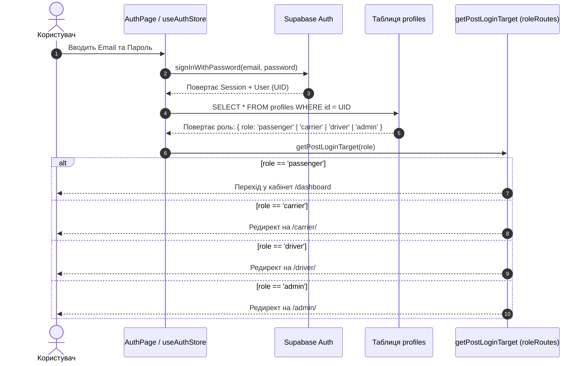

# 📖 ПОВНА БІБЛІЯ ПРОЄКТУ BUSNET: ВІД А ДО Я
> **Глибинний технічний та бізнес-довідник системи BUSNET (bus-net.it)**  
> Дата актуалізації: Листопад 2026 р.  
> Архітектура: Монорепозиторій (5 підсистем), Supabase Backend, Al-Trans API Gateway, React + Vite + Tailwind CSS.

---

## 📑 ЗМІСТ ДОКУМЕНТА
1. [Глобальна архітектура системи та піддомени](#1-глобальна-архітектура-системи-та-піддомени)
2. [5 Кабінетів системи: Хто є хто і як вони зв'язані](#2-5-кабінетів-системи-хто-є-хто-і-як-вони-звязані)
3. [Наскрізні ланцюжки (End-to-End процеси)](#3-наскрізні-ланцюжки-end-to-end-процеси)
   - 3.1. Реєстрація та логін (розподіл ролей)
   - 3.2. Ланцюжок бронювання квитка: куди йдуть дані та сповіщення
   - 3.3. Ланцюжок скасування квитка
   - 3.4. Автоприв'язка гостьових квитків
   - 3.5. Логіка визначення валюти (Італія EUR / Україна UAH)
4. [Лендінг та Пошук рейсів (apps/landing)](#4-лендінг-та-пошук-рейсів-appslanding)
5. [Кабінет Пасажира (/dashboard) — Кожна вкладка і кнопка](#5-кабінет-пасажира-dashboard---кожна-вкладка-і-кнопка)
6. [Кабінет Перевізника (/carrier/) — Кожна вкладка і кнопка](#6-кабінет-перевізника-carrier---кожна-вкладка-і-кнопка)
7. [Кабінет Водія (/driver/) — Інтерфейс рейсу в дорозі](#7-кабінет-водія-driver---інтерфейс-рейсу-в-дорозі)
8. [Кабінет Агента (/agent/) — Продаж та комісії](#8-кабінет-агента-agent---продаж-та-комісії)
9. [Адмін-панель (/admin/) — Головний контроль системи](#9-адмін-панель-admin---головний-контроль-системи)
10. [Синхронізація з Al-Trans API (Живий шлюз)](#10-синхронізація-з-al-trans-api-живий-шлюз)
11. [База Даних Supabase: Схема таблиць та зв'язки](#11-база-даних-supabase-схема-таблиць-та-звязки)
12. [РЕАЛЬНИЙ АУДИТ: Що працює, що не працює і що треба доробити](#12-реальний-аудит-що-працює-що-не-працює-і-що-треба-доробити)

---

## 1. Глобальна архітектура системи та піддомени

Проєкт реалізований як **Vite multi-app monorepo** під керуванням єдиного Express-шлюзу (`server.ts`) або Vercel-маршрутизатора:

```
bus-net.it (або localhost:3000)
 ├── /                  --> apps/landing (Лендінг, пошук, оформлення, кабінет пасажира /dashboard)
 ├── /carrier/          --> apps/carrier (Кабінет перевізника: маніфести, водії, автобуси, фінанси)
 ├── /driver/           --> apps/driver (Мобільний термінал водія: сканер посадки, список пасажирів)
 ├── /agent/            --> apps/agent (Кабінет касира/турагента: субагентські продажі, комісії)
 ├── /admin/            --> apps/admin (Супер-адміністратор: модерація, ліцензії, білінг, логи)
 └── /api/altrans/*     --> Проксі-сервер до офіційного API Al-Trans (обхід CORS + інжекція Api-Key)
```

Спільний код розташований у папці `packages/shared/src/`:
- `components/` — UI-компоненти, іконки, модалки, форми;
- `pages/` — сторінки та вкладки всіх кабінетів;
- `store/` — Zustand-сховища (`useAuthStore`, `useBookingStore`, `useAdminStore`);
- `lib/` — утиліти форматування цін, розрахунку валют, дат;
- `supabase/` — клієнт бази даних Supabase та конфігурація.

---

## 2. 5 Кабінетів системи: Хто є хто і як вони зв'язані

| Кабінет | Роль у системі (`role`) | Головне призначення | З ким комунікує |
| :--- | :--- | :--- | :--- |
| **Пасажир** | `passenger` (або `user`) | Пошук рейсів, бронювання без передоплати, QR-посадковий талон, збереження родини, відгуки. | З Перевізником (через бронь) та Водієм (показує QR-код). |
| **Перевізник** | `carrier` | Управління автопарком, створення рейсів, ведення відомостей, пасажири, фінанси за рейс. | Бачить бронювання від пасажирів та агентів, призначає водіїв. |
| **Водій** | `driver` | Робота безпосередньо в рейсі: посадка пасажирів за списком/QR, збір оплати готівкою, статус зайнятості місць. | Отримує список пасажирів від перевізника, змінює статус на `boarded`. |
| **Агент** | `agent` | Продаж квитків у касах/турагенціях, отримання агентської винагороди (% комісії). | Продає місця на рейси перевізників, створює замовлення. |
| **Адміністратор** | `admin` | Повний контроль: перевірка ліцензій перевізників, вирішення скарг, загальна виручка, логи безпеки. | Має доступ до всіх кабінетів, транзакцій та бази даних. |

---

## 3. Наскрізні ланцюжки (End-to-End процеси)

### 3.1. Реєстрація та логін (розподіл ролей)


### 3.2. Ланцюжок бронювання квитка: куди йдуть дані та сповіщення
1. **Дія на фронтенді**: На кроці 2 (`BookingPage`) користувач вводить дані (ПІБ, телефон, email) та обирає «Оплата водію».
2. **Запис у базу**: Викликається RPC `create_booking` або прямий `insert` у таблицю `bookings`:
   - `id`: згенерований UUID квитка;
   - `user_id`: UID користувача (якщо авторизований) або `null` (якщо гість);
   - `route_id`, `route_from`, `route_to`, `departure_date`, `departure_time`;
   - `passengers`: JSON-масив пасажирів із номерами обраних місць;
   - `contact`: телефон та email;
   - `status`: **`pending`** (очікує посадки та оплати водію);
   - `total_price`: розрахована сума;
   - `currency`: `'UAH'` або `'EUR'`.
3. **Гостьовий сейф**: Якщо пасажир купував без логіну, його `booking_id` додається в масив `localStorage.busnet_guest_bookings`.
4. **Сповіщення перевізнику**: Запис миттєво з'являється у кабінеті перевільника (`/carrier/bookings`) у реальному часі через `Supabase Realtime`.
5. **Сповіщення водію**: Рейс, призначений цьому водієві, автоматично показує нове зайняте місце у відомості посадки.
6. **Сповіщення пасажиру**: У кабінеті пасажира генерується запис у таблицю `notifications`: *"Ваше бронювання №... на рейс ... підтверджено"*.

### 3.3. Ланцюжок скасування квитка
1. Пасажир у вкладці «Мої квитки» тисне червону корзину.
2. З'являється внутрішній банер підтвердження (захист від випадкових кліків).
3. Після підтвердження статус у базі змінюється на `cancelled`.
4. Місце в автобусі звільняється:
   - Якщо це рейс із бази Supabase — лічильник `bookedSeats` зменшується;
   - Перевізник у кабінеті бачить статус «Скасовано»;
   - Водій бачить, що місце знову вільне для продажу на дорозі.

### 3.4. Автоприв'язка гостьових квитків
Коли людина бронює квиток без логіну (як гість), а потім заходить у кабінет або реєструється:
- `Dashboard.tsx` читає `localStorage.getItem('busnet_guest_bookings')`;
- Виконується SQL:
  ```sql
  UPDATE bookings SET user_id = current_user_uid WHERE id IN (guest_booking_ids);
  ```
- Квиток стає персональним і залишається в кабінеті назавжди!

### 3.5. Логіка визначення валюти (Італія EUR / Україна UAH)
- Контролюється модулем [`currencyUtils.ts`](file:///c:/Users/Tania/Desktop/busnet-fresh/packages/shared/src/lib/currencyUtils.ts).
- Перевіряє місто посадки (перше слово, без плутанини з містами на кшталт Приморська):
  - Посадка в Італії (Рим, Мілан, Болонья, Неаполь, Салерно...) ➔ **валюта EUR (€)**;
  - Посадка в Україні (Київ, Львів, Житомир, Рівне, Одеса...) ➔ **валюта UAH (грн)**.

---

## 4. Лендінг та Пошук рейсів (apps/landing)

### Елементи сторінки:
- **Хедер (`Header.tsx`)**:
  - Логотип `BUSNET UA`;
  - Навігація: «Маршрути», «Партнери», «FAQ», «Форум»;
  - Перемикач мов: `UA` / `EN` / `IT`;
  - Кнопка входу: показує «Увійти» або ім'я та статус кабінету.
- **Пошукова плашка (`HeroSection.tsx`)**:
  - Поля: «Звідки» (випадаючий список міст із бази + автодоповнення);
  - «Куди» (міста прибуття);
  - «Дата поїздки» (захист часового поясу через локальну дату);
  - Кнопка «Знайти квиток» — формує URL-параметри `/?from=...&to=...&date=...`.
- **Видача результатів (`SearchResults.tsx`)**:
  - Картка рейсу: логотип перевізника, час відправлення та прибуття, тривалість, автовокзали;
  - Бейджі зручностей: Wi-Fi, розетки 220V/USB, кондиціонер, біотуалет, гарячі напої;
  - Ціна з автоматичним форматуванням валюти;
  - Кількість вільних місць;
  - Кнопка «Обрати квиток» ➔ відкриває `/booking`.
- **База знань (`FAQSection.tsx`)**:
  - Акордеон із 7 фундаментальними відповідями (багаж, оплата водію, перетин кордону, тварини);
  - Вбудована JSON-LD розмітка `FAQPage` для пошукових систем та Gemini AI Overviews.
- **Банер конфіденційності (`CookieBanner.tsx`)**:
  - Відповідає законам Євросоюзу та Італії (ePrivacy / GDPR);
  - Google Consent Mode v2: за замовчуванням блокує стеження (`denied`), при згоді переводить у `granted`.

---

## 5. Кабінет Пасажира (/dashboard) — Кожна вкладка і кнопка

Головний файл: [`Dashboard.tsx`](file:///c:/Users/Tania/Desktop/busnet-fresh/packages/shared/src/pages/Dashboard.tsx) + [`DashboardLayout.tsx`](file:///c:/Users/Tania/Desktop/busnet-fresh/packages/shared/src/components/dashboard/DashboardLayout.tsx).

### 1. Вкладка «Огляд» (OverviewTab)
- **Привітання**: динамічне ім'я користувача;
- **Банер пропозиції**: прямі рейси до Італії з можливістю швидкого переходу до пошуку;
- **4 Статистичні плашки**:
  - «Активні квитки» — кількість актуальних бронювань;
  - «Всього поїздок» — сума завершених та поточних рейсів;
  - «Бонусні бали» — поточний баланс та рівень (Silver / Gold);
  - «Пасажири» — кількість збережених людей у записнику;
- **Картка найближчого рейсу**:
  - Міста відправлення та прибуття зі стрілкою;
  - Дата, час та номери обраних місць;
  - Кнопка «Посадковий талон» ➔ відкриває модалку з офлайн-QR кодом (SVG);
  - Кнопка «Всі квитки» ➔ перехід на вкладку квитків;
- **Швидкі дії**: кнопки «Пошук рейсів» та «Підтримка 24/7».

### 2. Вкладка «Мої квитки» (TicketsTab)
- **Фільтр підвкладок**: «Активні» (pending, confirmed), «Архів» (completed), «Скасовані» (cancelled);
- **Картка квитка**:
  - Кольорова бічна смужка статусу (блакитна — активний, зелена — завершений, червона — скасований);
  - Інформація: Дата, Час, Місця, Сума, Перевізник, ID квитка;
  - **Кнопка «Посадковий талон»**: відкриває модальне вікно з QR-кодом, яке адаптовано під екрани 360–390px;
  - **Кнопка «Друк»**: викликає системний діалог друку / збереження квитка у PDF (замінено старий блокнотний .txt);
  - **Кнопка «Скасувати»**: викликає діалог підтвердження з безпечним вивільненням місця.

### 3. Вкладка «Пасажири» (PassengersTab)
- **Картки збережених людей**:
  - Основний профіль (дані власника кабінету);
  - Члени сім'ї / попутники (ПІБ, номер паспорта, аватарка);
- **Кнопка «+ Додати пасажира»**: відкриває модалку, записує у таблицю `passengers` з валідним UUID та полями `first_name`, `last_name`, `doc`.
- **Кнопка видалення**: прибирає дані з бази (основного пасажира видалити не можна).

### 4. Вкладка «Бонуси» (BonusesTab)
- **Баланс балів**: 1 бал = 1 грн знижки;
- **Прогрес-бар статусу**: шкала від Silver (500) до Gold (2000 балів);
- **Реферальна система**: персональне посилання для запрошення друзів із нарахуванням балів за першу поїздку друга.

### 5. Вкладка «Профіль» (ProfileTab)
- Редагування імені, прізвища, номера телефону, пошти;
- Зміна пароля та мови інтерфейсу.

### 6. Вкладка «Історія поїздок» (HistoryTab)
- Список усіх рейсів, де пасажир уже проїхав;
- Кнопка «Залишити відгук» із виставленням оцінки від 1 до 5 зірок та текстовим коментарем.

### 7. Вкладка «Сповіщення» (NotificationsTab)
- Список повідомлень від диспетчера та системи (номер автобуса, номер платформи на вокзалі, підтвердження оплати);
- Лічильник непрочитаних на дзвіночку в шапці.

### 8. Вкладка «Форум попутників» (ForumTab)
- Список тем та порад від інших пасажирів (черги на кордоні, правила ввезення багажу, відгуки про автостанції);
- **Кнопка «Створити тему»**: публікація запитання у таблицю `forum_posts`;
- **Лайки**: безпечний підрахунок із захистом від повторного кліку через `liked_by`.

### 9. Вкладка «Підтримка» (SupportTab)
- Прямі кнопки відкриття чатів у Telegram, Viber, WhatsApp;
- Цілодобові номери телефонів диспетчерської служби.

---

## 6. Кабінет Перевізника (/carrier/) — Кожна вкладка і кнопка

Головний файл: [`CarrierDashboard.tsx`](file:///c:/Users/Tania/Desktop/busnet-fresh/packages/shared/src/pages/carrier/CarrierDashboard.tsx).

### 1. Головна панель (Дашборд)
- **Фінансові метрики**: Виручка за день/місяць, кількість перевезених пасажирів, середній чек;
- **Завантаженість рейсів**: графік проданих місць у відсотках;
- **Останні замовлення**: стрічка нових квитків у реальному часі.

### 2. Рейси та Розклад (Schedule / LiveTrips)
- Створення нового маршруту: зупинки, час, цінова матриця між містами;
- Схема автобуса: інтерактивний план поверхів (1 та 2 поверх), візуалізація зайнятих та вільних крісел.

### 3. Бронювання (BookingsTab)
- Таблиця всіх проданих та заброньованих квитків перевізника;
- Фільтри за статусами (`confirmed`, `pending`, `boarded`, `cancelled`);
- Пошук за прізвищем, номером квитка або рейсом;
- Ручне підтвердження або зняття броні диспетчером.

### 4. CRM Пасажирів (CRMTab)
- База всіх клієнтів, які хоча б раз їхали автобусами цього перевізника;
- Кількість поїздок кожного клієнта, загальна сума (LTV), контакти (телефон, email);
- Можливість експорту бази пасажирів у **CSV** для розсилок або звітності;
- Внесення проблемних пасажирів до чорного списку.

### 5. Автопарк (Fleet)
- Список автобусів компанії (марка, держномер, кількість місць, рік випуску);
- Прив'язка автобуса до конкретного графіка руху;
- Статус техогляду та страхових полісів.

### 6. Водії (Drivers)
- База штатних водіїв та стюардів;
- Призначення екіпажу на рейс;
- Логіни для доступу водіїв до мобільного терміналу `/driver/`.

### 7. Фінанси та Звіти (FinanceTab / InvoicesTab)
- Розрахунок готівки, зібраної водіями на рейсах;
- Безготівкові надходження від онлайн-продажів;
- Виставлення рахунків та актів виконаних робіт.

---

## 7. Кабінет Водія (/driver/) — Інтерфейс рейсу в дорозі

Файл: `DriverDashboard.tsx`. Спеціально оптимізований під роботу зі смартфона однією рукою:
- **Вибір поточного рейсу**: наприклад, «Київ — Рим, 10.11.2026»;
- **Посадкова відомість**: список усіх пасажирів, розбитих по зупинках виїзду;
- **QR-сканер**: зчитує камерою смартфона код із квитка пасажира та автоматично ставить позначку `boarded` (посаджений);
- **Каса готівки**: фіксація отриманих грошей від пасажирів, які обрали оплату при посадці;
- **Колонка вільних місць**: водій бачить, які крісла звільнилися по дорозі (наприклад, після висадки в Болоньї), і може продати їх новим пасажирам до Риму.

---

## 8. Кабінет Агента (/agent/) — Продаж та комісії

Файл: `AgentDashboard.tsx`:
- Призначений для туристичних фірм, автовокзальних кас та субагентів;
- Пошук рейсів усіх підключених до BUSNET перевізників;
- Оформлення квитка клієнту на касі з друком фірмового бланка;
- Баланс агентського депозиту та лічильник заробленої комісії (наприклад, 8–10% від кожного проданого квитка).

---

## 9. Адмін-панель (/admin/) — Головний контроль системи

Файл: `DashboardTab.tsx` / `AdminLayout.tsx`:
- **Супер-контроль усіх операцій**:
  - `CarriersTab`: модерація перевізників, увімкнення/вимкнення API-шлюзів;
  - `ApprovalsTab`: перевірка ліцензій на міжнародні перевезення;
  - `TransactionsTab`: глобальний аудит усіх фінансових транзакцій системи;
  - `LogsTab`: системний журнал подій безпеки (хто залогінився, хто скасував квиток, помилки API);
  - `ConflictsTab`: арбітраж спірних ситуацій між пасажирами та перевізниками (повернення коштів, зриви рейсів).

---

## 10. Синхронізація з Al-Trans API (Живий шлюз)

Для перевізника **Al-Trans (Альтранс)** реалізовано автоматичний проксі-шлюз у `server.ts` та сервіс [`altransLiveService.ts`](file:///c:/Users/Tania/Desktop/busnet-fresh/packages/shared/src/services/altransLiveService.ts):
- **Маршрут шлюзу**: `/api/altrans/*` ➔ проксує на `https://al-trans.com.ua/api/...`
- **Автоматична підстановка секретних заголовків на серверному шлюзі**:
  - `Api-Key: process.env.ALTRANS_API_KEY` (надійно приховано на сервері, клієнтський браузер ніколи не бачить ключ)
  - `Accept-Language: uk`
- **Діючі ендпоінти**:
  1. `POST /api/v2/booking/search_trips` — живий пошук рейсів за датою та ID міст;
  2. `GET /api/v3/booking/get_bus_map_for_trip_id?tripId=...` — повертає інтерактивну карту розсадки автобуса із зайнятими місцями (`status: purchased / reserved`).
- **Захист від блокувань**: запити кешуються на 5 хвилин (Singleton Cache), щоб не створювати паразитного навантаження на сервери Альтранса.

---

## 11. База Даних Supabase: Схема таблиць та зв'язки

```
                +-------------------+
                |     profiles      |
                | (id, role, name)  |
                +---------+---------+
                          | 1
                          |
                          | N
+-------------------+     |     +-------------------+
|      routes       |     |     |     passengers    |
| (id, carrier_id)  |     |     | (id, user_id, doc)|
+---------+---------+     |     +-------------------+
          | 1             |
          |               |
          | N             | N
+---------+---------------+---------+
|                bookings           |
| (id, user_id, route_id, seats,    |
|  status, total_price, currency)   |
+-----------------------------------+
```

### Основні таблиці:
1. **`profiles`**: акаунти системи. Поля: `id` (auth.uid), `email`, `role` (`passenger`, `carrier`, `driver`, `admin`, `agent`), `first_name`, `last_name`, `phone`, `company_name`.
2. **`bookings`**: серце системи квитків. Поля: `id`, `user_id`, `route_id`, `route_from`, `route_to`, `departure_date`, `departure_time`, `seats` (масив місць), `passengers` (JSON), `status` (`pending`, `confirmed`, `boarded`, `cancelled`, `completed`), `total_price`, `currency`.
3. **`passengers`**: записник попутників користувача. Поля: `id`, `user_id`, `name`, `first_name`, `last_name`, `role`, `doc`.
4. **`routes`**: налаштування маршрутів перевізників. Поля: `id`, `carrier_id`, `operator`, `currency`, `outbound` (зупинки, розклад, ціни), `inbound`.
5. **`notifications`**: персональні сповіщення. Поля: `id`, `user_id`, `title`, `message`, `read`, `created_at`.
6. **`forum_posts`**: публікації спільноти. Поля: `id`, `user_id`, `author_name`, `content`, `category`, `likes_count`, `liked_by` (масив UID).

---

## 12. РЕАЛЬНИЙ АУДИТ: Що працює, що не працює і що треба доробити

Нижче чесний інженерний статус кожного вузла системи:

### ✅ ЩО ПРАЦЮЄ БЕЗДОГАННО (100% готовність):
1. **Пошук рейсів та видача**: працює швидко, з адаптивними цінами та бейджами зручностей.
2. **Логіка валют**: жорстко розмежована — виїзд з України завжди в `UAH (грн)`, виїзд з Італії завжди в `EUR (€)`.
3. **Оформлення квитка**: вибір місць, введення даних, вибір готівкової оплати водію.
4. **Кабінет пасажира**:
   - Статуси `pending` та `confirmed` закріплені як активні (більше не падають у минулі);
   - Генерація посадкового талона з офлайн QR-кодом (працює без інтернету через SVG);
   - Друк / збереження квитка у PDF (прибрано старий `.txt`);
   - Додавання та видалення попутників із валідними UUID;
   - Захист від білого екрана в парсері маршрутів (`parseRoute`).
5. **Автоприв'язка гостьових квитків**: при реєстрації після покупки квиток автоматично зв'язується з новим акаунтом.
6. **SEO та підключення до Google**:
   - Метатеги, `sitemap.xml`, `robots.txt`, `llms.txt`;
   - Мікророзмітка `TravelAgency` та `FAQPage` для Google Gemini AI Overviews;
   - GDPR Cookie Consent Banner з Google Consent Mode v2 та підключеним GA4 (`G-RVF18NQGCH`).

---

### ⚠️ ЩО ПОТРЕБУЄ ДООПРАЦЮВАННЯ АБО ПІДКЛЮЧЕННЯ:

1. **Імена та телефони пасажирів Альтранса у кабінеті перевізника**:
   - *Поточний стан*: За API-ключем Альтранса на сервері видно зайнятість місць (наприклад, 31 зайняте місце на рейс 31145), але замість ПІБ повертається `Пасажир (Місце №)`, оскільки персональні дані пасажирів закриті авторизацією диспетчера.
   - *Що треба*: Отримати від керівництва Альтранса Bearer-токен або пароль диспетчера до їхньої адмінки, щоб наш бекенд підтягував телефони та ПІБ пасажирів з їхньої внутрішньої бази.
2. **SMS та Viber розсилка квитків**:
   - *Поточний стан*: Квиток миттєво з'являється на екрані та в кабінеті, формується QR-код.
   - *Що треба*: Підключити шлюз SMS/Viber розсилок (наприклад, TurboSMS або eSputnik), щоб пасажирам без додатку приходило пряме смс-повідомлення з номером місця та посиланням на квиток.
3. **Платіжний еквайринг для онлайн-оплат карткою**:
   - *Поточний стан*: Основний потік іде через «Оплату готівкою водію».
   - *Що треба*: Для пасажирів, які бажають сплатити карткою на сайті, підключити мерчант WayForPay, LiqPay або Stripe у `BookingPage`.
4. **Push-сповіщення водія на телефоні**:
   - *Поточний стан*: Кабінет водія оновлюється через веб-інтерфейс.
   - *Що треба*: Налаштувати Service Worker Web Push, щоб водій чув звуковий сигнал, коли диспетчер додає нового пасажира на проміжній зупинці.

