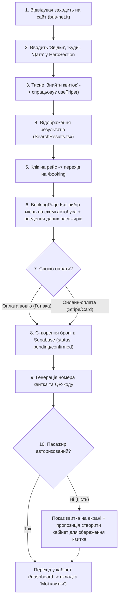

# 🗺️ ПОВНА АРХІТЕКТУРА ТА ЛОГІКА ПАСАЖИРСЬКОГО ФЛОУ: ВІД ПОШУКУ ДО КАБІНЕТУ

> **Ціль документа**: Докладний гід-скелет для самостійного редагування, доопрацювання та масштабування пасажирського функціоналу в проєкті **BUSNET**. Тут розписано кожен крок пасажира, назви файлів, хуки, сховища стану (Zustand/Context), роботу з базою Supabase та зовнішніми API.

---

## 📌 ЗМІСТ
1. [Карта файлів проєкту (Де що шукати)](#1-карта-файлів-проєкту-де-що-шукати)
2. [Повний життєвий цикл пасажира (User Flow)](#2-повний-життєвий-цикл-пасажира-user-flow)
3. [Етап 1: Пошук рейсів на Лендінгу](#етап-1-пошук-рейсів-на-лендінгу)
4. [Етап 2: Видача результатів пошуку (SearchResults)](#етап-2-видача-результатів-пошуку-searchresults)
5. [Етап 3: Бронювання та вибір місць (BookingPage)](#етап-3-бронювання-та-вибір-місць-bookingpage)
6. [Етап 4: Авторизація та Реєстрація (AuthPage / useAuthStore)](#етап-4-авторизація-та-реєстрація-authpage--useauthstore)
7. [Етап 5: Кабінет Пасажира (Dashboard.tsx та всі вкладки)](#етап-5-кабінет-пасажира-dashboardtsx-та-всі-вкладки)
8. [Робота з даними: Supabase та Al-Trans API](#8-робота-з-даними-supabase-та-al-trans-api)
9. [Як самостійно вносити зміни (Шпаргалка розробника)](#9-як-самостійно-вносити-зміни-шпаргалка-розробника)

---

## 1. Карта файлів проєкту (Де що шукати)

Усі ключові компоненти пасажира знаходяться у монорепозиторії:
- **`apps/landing/`** — точка входу клієнтського додатку:
  - `apps/landing/src/App.tsx` — роутинг лендінгу (`/`, `/booking`, `/auth`, `/dashboard`, `/forum`)
  - `apps/landing/index.html` — SEO-метатеги, розмітка Google, аналітика GA4 та Consent Mode
  - `apps/landing/public/` — статичні файли (`robots.txt`, `sitemap.xml`, `llms.txt`, іконки)
- **`packages/shared/src/`** — спільний код (UI, сторінки, логіка, бекенд-інтеграції):
  - **Сторінки:**
    - `pages/HomePage.tsx` — Головна сторінка з пошуком та всіма маркетинговими секціями
    - `pages/BookingPage.tsx` — Сторінка оформлення квитка (введення ПІБ, вибір місць, оплата)
    - `pages/AuthPage.tsx` — Вхід, реєстрація та скидання пароля
    - `pages/Dashboard.tsx` — Головний контролер Кабінету пасажира (`/dashboard`)
  - **Компоненти пошуку (на лендінгу):**
    - `components/home/HeroSection.tsx` — форма введення «Звідки», «Куди», «Дата»
    - `components/home/SearchResults.tsx` — список знайдених рейсів із фільтрами та цінами
    - `components/home/FAQSection.tsx` — відповіді на питання пасажирів (FAQ)
  - **Вкладки Кабінету Пасажира (`components/dashboard/`):**
    - `DashboardLayout.tsx` — сайдбар, верхня плашка, мобільне меню та перемикач мов
    - `OverviewTab.tsx` — головний екран кабінету (активний найближчий квиток, швидкі дії)
    - `TicketsTab.tsx` — список усіх куплених та заброньованих квитків (PDF, деталі, статус)
    - `PassengersTab.tsx` — збережені дані пасажирів (сім'я, друзі) для швидкого автозаповнення
    - `BonusesTab.tsx` — кешбек, бали лояльності, реферальні запрошення
    - `ProfileTab.tsx` — персональні дані (ПІБ, телефон, email, мова)
    - `HistoryTab.tsx` — архів минулих завершених поїздок
    - `NotificationsTab.tsx` — сповіщення про зміну платформи, затримки або підтвердження
    - `SupportTab.tsx` — чат/кнопки швидкого зв'язку з диспетчером (Viber, Telegram, WhatsApp)
  - **Сховища стану (Zustand & Context):**
    - `store/useBookingStore.ts` — збереження поточного рейсу, обраних місць, даних пасажирів під час оформлення
    - `store/useAuthStore.ts` — сесія користувача в Supabase, роль (`passenger`, `carrier`, `admin`), профіль
    - `context/SearchContext.tsx` — глобальні параметри пошуку (`from`, `to`, `date`)
    - `hooks/useTrips.ts` — хук завантаження рейсів із Supabase + Al-Trans API

---

## 2. Повний життєвий цикл пасажира (User Flow)



---

## 3. Етап 1: Пошук рейсів на Лендінгу

### Де дивитись код:
- Форма пошуку: `packages/shared/src/components/home/HeroSection.tsx`
- Контекст пошуку: `packages/shared/src/context/SearchContext.tsx`
- Логіка завантаження: `packages/shared/src/hooks/useTrips.ts`

### Як працює логіка:
1. Користувач обирає місто відправлення (наприклад, «Київ» або «Львів») та місто прибуття («Рим», «Мілан», «Болонья»).
2. Дата встановлюється за локальним часом через функцію `getLocalDate()` (захист від зміщення часових поясів UTC).
3. При натисканні кнопки **«Знайти квиток»** параметри записуються в URL-запит: `/?from=Київ&to=Рим&date=2026-11-10`.
4. Це дозволяє пасажирам ділитися прямим посиланням на пошук у месенджерах, а пошуковим роботам — індексувати готові результати.

---

## 4. Етап 2: Видача результатів пошуку (SearchResults)

### Де дивитись код:
- `packages/shared/src/components/home/SearchResults.tsx`

### Що тут відбувається:
1. `useTrips()` одночасно шукає рейси:
   - У власній базі даних **Supabase** (таблиця `routes` та `trips`);
   - У зовнішньому шлюзі **Al-Trans API** (через `/api/altrans/...`).
2. Кожна картка рейсу показує:
   - Час та місто виїзду/прибуття;
   - Назву автостанції (наприклад, *Autostazione Tiburtina*);
   - Назву перевізника та модель автобуса (наприклад, *Van Hool Astromega*);
   - Ціну в EUR / UAH;
   - Кількість вільних місць;
   - Іконки зручностей (Wi-Fi, 220V, WC, клімат).
3. При кліку **«Обрати рейс»** об'єкт обраного рейсу зберігається у `useBookingStore.getState().setTrip(trip)` і відбувається перехід на `/booking`.

---

## 5. Етап 3: Бронювання та вибір місць (BookingPage)

### Де дивитись код:
- Головний файл сторінки: `packages/shared/src/pages/BookingPage.tsx`
- Сховище стану: `packages/shared/src/store/useBookingStore.ts`

### Логіка по кроках:
- **Крок 1: Вибір місця на інтерактивній схемі автобуса:**
  - Якщо рейс Al-Trans — викликається `/api/v3/booking/get_bus_map_for_trip_id`, що повертає точну карту місць автобуса (1-й та 2-й поверхи).
  - Зайняті місця блокуються червоним/сірим, вільні — доступні для вибору.
- **Крок 2: Введення даних пасажирів:**
  - Ім'я та Прізвище (латиницею або кирилицею відповідно до паспорта);
  - Номер телефону (для зв'язку водія);
  - Email (для надсилання електронного квитка).
- **Крок 3: Вибір способу розрахунку:**
  - *«Оплата при посадці»* (найпопулярніший варіант для українських пасажирів);
  - *«Оплата карткою онлайн»*.
- **Крок 4: Створення запису в базі:**
  - Запис додається в таблицю `bookings` у Supabase:
    - `user_id` — ID пасажира (якщо залогінений) або `null` (для гостя);
    - `trip_id`, `route_from`, `route_to`, `departure_date`;
    - `passengers` — JSON-масив з іменами та номерами місць;
    - `status` — `'confirmed'` або `'pending'`;
    - `total_price` — сума в євро.

---

## 6. Етап 4: Авторизація та Реєстрація (AuthPage / useAuthStore)

### Де дивитись код:
- Інтерфейс авторизації: `packages/shared/src/pages/AuthPage.tsx`
- Логіка аутентифікації: `packages/shared/src/store/useAuthStore.ts`
- Маршрутизація за ролями: `packages/shared/src/constants/roleRoutes.ts`

### Як система розуміє, куди перенаправляти:
Коли користувач вводить Email та Пароль:
1. Supabase перевіряє облікові дані (`supabase.auth.signInWithPassword`).
2. Завантажується профіль з таблиці `profiles` за його `UID`.
3. Визначається роль:
   - `passenger` ➔ відкривається кабінет пасажира `/dashboard`
   - `carrier` ➔ відкривається кабінет перевізника `/carrier/`
   - `driver` ➔ кабінет водія `/driver/`
   - `admin` ➔ адмін-панель `/admin/`
4. Для захисту сторінки кабінету використовується обгортка `ProtectedRoute.tsx`: якщо неавторизований — м'яко перекидає на `/auth`.

---

## 7. Етап 5: Кабінет Пасажира (Dashboard.tsx та всі вкладки)

Кабінет пасажира (`/dashboard`) спроєктований за модульним принципом на базі вкладок (Tabs).

### Головний файл-координатор:
`packages/shared/src/pages/Dashboard.tsx`
- Керує активною вкладкою через стан `activeTab` (за замовчуванням `'overview'`).
- Автоматично завантажує з Supabase всі квитки користувача:
  ```typescript
  supabase.from('bookings').select('*').eq('user_id', user.uid)
  ```
- Якщо знайдено збережені локальні квитки від гостьових замовлень — автоматично прив'язує їх до профілю.

### Вкладки та їхня функціональність:

| Вкладка | Файл компонента | Що робить і що можна редагувати |
| :--- | :--- | :--- |
| **Огляд (Overview)** | `OverviewTab.tsx` | Відображає банер найближчої поїздки, зворотний відлік до відправлення, баланс бонусів, статус посадки. |
| **Мої квитки (Tickets)** | `TicketsTab.tsx` | Список активних поїздок, кнопка скачування посадкового талона (PDF), номер місця, контакти перевізника, адреса посадки. |
| **Пасажири (Passengers)** | `PassengersTab.tsx` | Записник пасажирів: ПІБ, паспортні дані, дата народження. Дозволяє в 1 клік підставляти рідних при новому бронюванні. |
| **Бонуси (Bonuses)** | `BonusesTab.tsx` | Програма лояльності: накопичені євро/бали за кілометри, реферальне посилання для друзів, промокоди. |
| **Профіль (Profile)** | `ProfileTab.tsx` | Зміна імені, контактного телефону, email, аватарки, пароля. |
| **Історія (History)** | `HistoryTab.tsx` | Архів завершених рейсів, можливість повторити поїздку або залишити відгук про автобус. |
| **Сповіщення (Notifications)**| `NotificationsTab.tsx` | Повідомлення від перевізника: номер платформи, марка та держномер автобуса, можливі затримки на кордоні. |
| **Підтримка (Support)** | `SupportTab.tsx` | Прямий зв'язок: онлайн-чат, кнопки відкриття чатів у Telegram, Viber, WhatsApp та номери гарячої лінії. |

---

## 8. Робота з даними: Supabase та Al-Trans API

### Структура таблиці `bookings` у Supabase:
- `id` (uuid) — унікальний ідентифікатор квитка
- `user_id` (uuid) — зв'язок із таблицею `profiles.id`
- `route_from` (text) — місто виїзду (наприклад, "Київ")
- `route_to` (text) — місто прибуття (наприклад, "Рим")
- `departure_date` (text / date) — дата рейсу
- `seats` (text[] / json) — масив номерів місць (наприклад, `["14", "15"]`)
- `passengers` (jsonb) — список пасажирів: `[{ "firstName": "Іван", "lastName": "Коваленко" }]`
- `status` (text) — `'confirmed'` (підтверджено), `'pending'` (очікує посадки), `'cancelled'` (скасовано)
- `total_price` (numeric) — фінальна ціна
- `currency` (text) — валюта (`EUR` або `UAH`)

---

## 9. Як самостійно вносити зміни (Шпаргалка розробника)

### 1. Змінити текст або переклад у кабінеті:
Відкрий `packages/shared/src/pages/Dashboard.tsx` і знайди об'єкт `translations`:
```typescript
const translations = {
  ua: {
    tickets: 'Мої квитки',
    welcome: 'Привіт, пасажире!',
    // змінюй потрібні фрази тут
  }
}
```

### 2. Додати нове поле для пасажира (наприклад, серія паспорта):
1. Відкрий `packages/shared/src/pages/BookingPage.tsx`.
2. У формі введення пасажирів додай новий `input`:
   ```tsx
   <input 
     placeholder="Номер закордонного паспорта"
     value={passenger.docNumber}
     onChange={(e) => updatePassenger(index, 'docNumber', e.target.value)}
   />
   ```
3. Додай збереження цього поля у `useBookingStore.ts`.

### 3. Змінити контакти підтримки:
Відкрий `packages/shared/src/components/dashboard/SupportTab.tsx` або `packages/shared/src/components/home/AppEcoSection.tsx` і вкажи актуальні телефони та посилання на Telegram/Viber ботів.

### 4. Збірка та перевірка після правок:
Щоб переконатися, що правки не зламали код, запусти в терміналі:
```powershell
npx vite build apps/landing
```
Якщо збірка завершилася повідомленням `built in ...s` — сайт готовий до оновлення на сервері!

